

  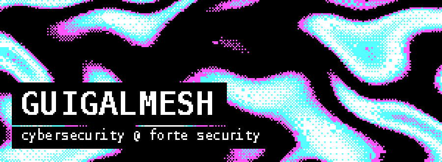

 

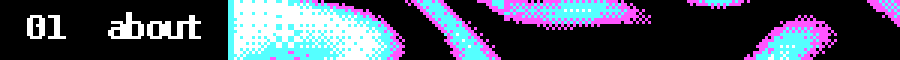

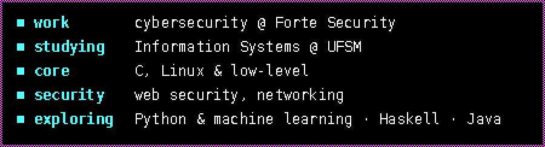

 

<a href="https://github.com/guigalmesh/analisador-de-headerhttp">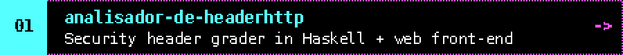</a>
<a href="https://github.com/guigalmesh/visualizador-algoritmos">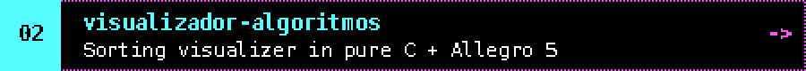</a>
<a href="https://github.com/guigalmesh/ml-rotofauna-atropelada">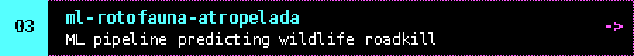</a>
<a href="https://github.com/guigalmesh/simple-keylogger-c">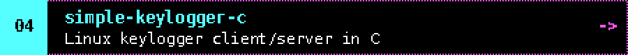</a>
<a href="https://github.com/guigalmesh/general-deck-game">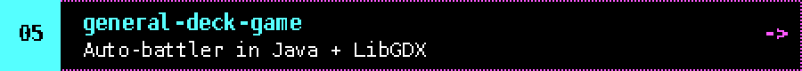</a>
<a href="https://github.com/guigalmesh/jogo-da-forca-mips">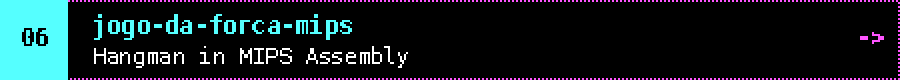</a>

 

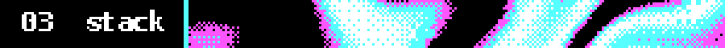

  
  
  
  
  
  
  
  

  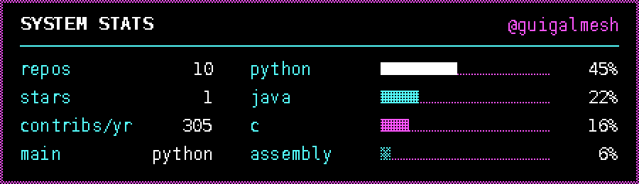

  
  

