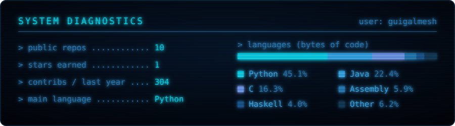

<div align="center">
  
</div>

<br>



I'm an **Information Systems** student at **UFSM** with a passion for low-level programming and a strong focus on **cybersecurity**. I'm currently looking for opportunities to enter the job market and put my skills to work.

```txt
[ SEEKING  ]  my first opportunity in the tech industry
[ STUDYING ]  Information Systems @ UFSM
[ CODING   ]  C — exploring how things work under the hood
[ FOCUS    ]  cybersecurity & networking
[ LEARNING ]  Python, for scripting and automation
```

<details>
<summary><b>🇧🇷 Versão em português</b></summary>

Sou estudante de **Sistemas de Informação** na **UFSM**, apaixonado por programação de baixo nível e com foco em **cibersegurança**. Estou em busca de oportunidades para entrar no mercado de trabalho e colocar minhas habilidades em prática.

```txt
[ BUSCANDO   ]  minha primeira oportunidade na área de tecnologia
[ ESTUDANDO  ]  Sistemas de Informação @ UFSM
[ PROGRAMO   ]  em C — entendendo como as coisas funcionam por baixo
[ FOCO       ]  cibersegurança e redes
[ APRENDENDO ]  Python, para scripts e automação
```

Quer conversar sobre código, segurança da informação ou tecnologia em geral? Me chama nos contatos abaixo.

</details>

<br>



<p align="left">
  
  
  
  
  
  
</p>



<p align="center">
  
</p>



<p align="left">
  <a href="https://tryhackme.com/p/guigalmesh"></a>
</p>



Feel free to hit me up if you want to chat about code, infosec, or tech in general.
<br><sub>🇧🇷 Fique à vontade para me chamar e conversar sobre código, segurança ou tecnologia.</sub>

<p align="left">
  <a href="https://www.linkedin.com/in/guilherme-martini-7645513b4/"></a>
  <a href="mailto:guilherme.dcmartini@gmail.com"></a>
</p>
